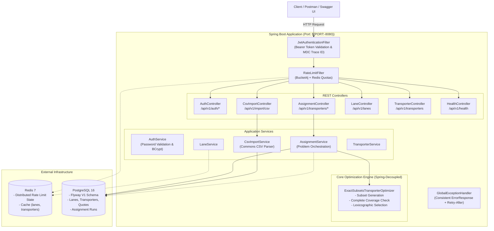
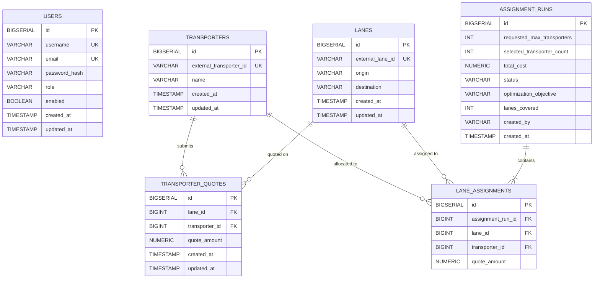

# FreightFox Transporter Assignment Platform

A production-grade, secure, cloud-ready REST backend platform built for the **FreightFox Transporter Assignment on Lanes** hiring assignment. The platform ingests trade lanes, transporters, and cost quote matrices via JSON APIs or CSV upload, validates input datasets, and solves the optimal transporter-to-lane assignment problem under cost minimization, transporter limits, and complete coverage constraints.

---

## Table of Contents

1. [Project Overview](#project-overview)
2. [Business Problem](#business-problem)
3. [Key Features](#key-features)
4. [Technology Stack](#technology-stack)
5. [Architecture Diagram](#architecture-diagram)
6. [Database Schema & ER Diagram](#database-schema--er-diagram)
7. [Core Optimization Engine](#core-optimization-engine)
   - [Formal Problem Formulation](#formal-problem-formulation)
   - [Lexicographic Objective](#lexicographic-objective)
   - [Algorithm & Proof of Optimality](#algorithm--proof-of-optimality)
   - [Complexity Analysis & Scalability Safeguards](#complexity-analysis--scalability-safeguards)
8. [API Endpoints Reference](#api-endpoints-reference)
9. [Authentication & Role-Based Authorization](#authentication--role-based-authorization)
10. [Password Validation Policy](#password-validation-policy)
11. [Distributed Redis Rate Limiting](#distributed-redis-rate-limiting)
12. [Redis Caching & Invalidation Strategy](#redis-caching--invalidation-strategy)
13. [CSV Format & Import Workflow](#csv-format--import-workflow)
14. [Local Development Setup](#local-development-setup)
15. [Environment Variables Reference](#environment-variables-reference)
16. [Docker & Containerization](#docker--containerization)
17. [Automated Testing & Benchmark Results](#automated-testing--benchmark-results)
18. [Railway Deployment Guide](#railway-deployment-guide)
19. [Swagger / OpenAPI Documentation](#swagger--openapi-documentation)
20. [Example API Requests & Responses](#example-api-requests--responses)
21. [Security & Production Hardening](#security--production-hardening)
22. [Loom Demonstration Checklist](#loom-demonstration-checklist)

---

## 1. Project Overview

Freight transport logistics across Indian trade corridors involves assigning multiple transport service providers across high-volume trade lanes. To balance supplier diversification and operational consolidation, logistics managers impose a ceiling on the number of distinct transporters permitted ($K$). Within that ceiling, every lane must be covered by a transporter that submitted a quote, and the overall freight spend must be minimized while maximizing utilization of the permitted transporters.

This application provides:
- Exact combinatorial optimization solving the problem to global optimality.
- Ingestion via original JSON specifications and transactional CSV upload.
- Full Spring Security with JWT Bearer authentication and role-based access control (RBAC).
- Redis-backed distributed token-bucket rate limiting via Bucket4j.
- Distributed Redis caching with multi-entity eviction.
- Normalized PostgreSQL persistence managed via Flyway migrations.
- Dynamic JDBC connection synthesis for Railway, Render, and containerized deployments.

---

## 2. Business Problem

Given:
- $N$ Trade Lanes (e.g., *Mumbai &rarr; Delhi*, *Delhi &rarr; Bangalore*, etc.)
- $M$ Transporters (e.g., *T1, T2, ... T7*)
- Cost Quote Matrix $C_{i, j}$ where transporter $j$ quotes rate $C_{i, j} > 0$ on lane $i$
- Transporter Limit $K \ge 1$

**Constraints & Objectives:**
1. **Full Lane Coverage:** Every lane $i \in \{1, \dots, N\}$ must be assigned to exactly one transporter $j$.
2. **Transporter Limit:** At most $K$ distinct transporters may be utilized in the final assignment.
3. **Valid Quotes Only:** Missing quotes must never be treated as zero cost or assigned arbitrarily.
4. **Lexicographic Optimization:**
   - **Priority 1:** Maximize the number of distinct transporters utilized ($M_{used} \le K$) to foster competitive supplier diversity.
   - **Priority 2:** Minimize total cost $\sum_{i=1}^N C_{i, j_i}$ among solutions achieving maximal transporter utilization.
   - **Priority 3:** Deterministic tie-breaking on lexicographical transporter IDs.

---

## 3. Key Features

- **Exact Combinatorial Optimizer:** Evaluates candidate transporter subsets to guarantee global cost minimality.
- **REST Contract Compliance:** Retains exact compatibility with the assignment's original primary endpoints:
  - `POST /api/v1/transporters/input`
  - `POST /api/v1/transporters/assignment`
- **Transactional CSV Importer:** Parses `transporter_assignment_data.csv`, validates headers, detects duplicates, trims whitespace, and ensures atomic database upserts.
- **Enterprise Security:** BCrypt password hashing, JWT signing/verification, deny-by-default endpoint authorization, and admin bootstrap.
- **Distributed Rate Limiting:** Redis + Bucket4j distributed token bucket with tier-based quotas and safe in-memory fallback.
- **Zero-Downtime Database Migrations:** Flyway-managed schema creation with PostgreSQL constraints and indexes.
- **Interactive API Documentation:** Full OpenAPI 3 / Swagger UI with Bearer JWT authentication testing.

---

## 4. Technology Stack

| Component | Technology | Version | Description |
|---|---|---|---|
| Runtime | Java OpenJDK | 21.0.12 LTS | Virtual threads and modern pattern matching |
| Framework | Spring Boot | 3.3.4 | Core enterprise application framework |
| Security | Spring Security + JJWT | 6.3 / 0.12.6 | Stateless JWT Bearer authentication |
| Persistence | Spring Data JPA / Hibernate | 6.5.3 | Object-relational mapping |
| Database | PostgreSQL / H2 | 16 / 2.2 | Production PostgreSQL / local test fallback |
| Migrations | Flyway | 10.15 | Versioned database schema migrations |
| Cache & Rate Limit | Spring Data Redis + Bucket4j | 3.3.4 / 8.10.1 | Distributed cache and token bucket rate limiter |
| CSV Processing | Apache Commons CSV | 1.11.0 | Robust RFC 4180 CSV parser |
| Documentation | Springdoc OpenAPI | 2.6.0 | OpenAPI 3.0 & Swagger UI |
| Build Tool | Apache Maven | 3.9.16 | Multi-stage container packaging |
| Containerization | Docker & Docker Compose | Multi-stage | Non-root Alpine runtime image |

---

## 5. Architecture Diagram



---

## 6. Database Schema & ER Diagram

The PostgreSQL database schema is strictly managed via Flyway (`db/migration/V1__init_schema.sql`).



---

## 7. Core Optimization Engine

### Formal Problem Formulation

Let:
- $L = \{l_1, l_2, \dots, l_N\}$ be the set of lanes.
- $T = \{t_1, t_2, \dots, t_M\}$ be the set of available transporters.
- $C(l, t) \in \mathbb{R}^+$ be the quote amount if transporter $t$ quotes on lane $l$.
- $K \ge 1$ be the user-specified maximum transporter limit.

A feasible assignment is a mapping $\sigma: L \to T$ such that:
1. $C(l, \sigma(l))$ exists for all $l \in L$.
2. The set of used transporters $U(\sigma) = \{\sigma(l) \mid l \in L\}$ satisfies $|U(\sigma)| \le K$.

### Lexicographic Objective

1. **Maximize Transporter Usage:** $\max |U(\sigma)|$ subject to $|U(\sigma)| \le K$.
2. **Minimize Cost:** Minimize $\sum_{l \in L} C(l, \sigma(l))$ among assignments achieving the maximum transporter count.
3. **Deterministic Tie-Breaking:** If two solutions have identical used transporter count and identical cost, ties are broken deterministically by sorting transporter IDs lexicographically, then by lane allocation.

### Algorithm & Proof of Optimality

**Algorithm:**
1. Generate candidate transporter subsets $S \subseteq T$ of cardinality $k \in \{1, \dots, \min(K, M)\}$.
2. For each subset $S$:
   - Check if $S$ covers all lanes: for every $l \in L$, $\exists t \in S$ with a quote $C(l, t)$. If not, discard $S$.
   - For each lane $l$, greedily assign $t^*(l) = \arg\min_{t \in S} C(l, t)$ (tie-breaking on lowest $t$).
   - Compute total cost $\text{Cost}(S) = \sum_{l \in L} C(l, t^*(l))$ and actual used transporters $U(S) = \{t^*(l) \mid l \in L\}$.
3. Sort all feasible solutions by the lexicographic comparator:
   $$(-|U(S)|, \text{Cost}(S), \text{lex}(U(S)))$$
4. Return the top candidate.

**Proof of Optimality:**  
Any feasible assignment $\sigma$ utilizes a set of distinct transporters $U(\sigma)$ of size $\le K$. Because $U(\sigma) \subseteq T$ and $|U(\sigma)| \le K$, $U(\sigma)$ is identical to at least one enumerated subset $S$. For any fixed subset $S$, each lane assignment decision $t^*(l)$ is independent because there are no mutual capacity constraints across lanes. Thus, choosing the minimum cost quote for each lane independently within $S$ guarantees the minimum possible cost achievable using transporters from $S$. Exhaustive evaluation across all candidate subsets of size $\le K$ therefore guarantees reaching the global optimum.

### Benchmark on Provided Hiring Dataset

Running the optimizer on the actual `transporter_assignment_data.csv` (9 trade lanes, 7 transporters, 63 quotes) with $K=3$:
- **Total Minimum Cost:** **₹134,876.00**
- **Selected Transporters:** **T1, T4, T6** (3 transporters used)
- **Lanes Covered:** 9/9
- **Allocations:**
  - Lane 1 &rarr; T4 (₹14,400.00)
  - Lane 2 &rarr; T1 (₹10,512.00)
  - Lane 3 &rarr; T4 (₹14,316.00)
  - Lane 4 &rarr; T4 (₹10,678.00)
  - Lane 5 &rarr; T4 (₹13,032.00)
  - Lane 6 &rarr; T1 (₹13,567.00)
  - Lane 7 &rarr; T1 (₹10,015.00)
  - Lane 8 &rarr; T6 (₹10,492.00)
  - Lane 9 &rarr; T6 (₹37,864.00)
  - **Sum:** ₹14,400 + ₹10,512 + ₹14,316 + ₹10,678 + ₹13,032 + ₹13,567 + ₹10,015 + ₹10,492 + ₹37,864 = **₹134,876.00**

---

## 8. API Endpoints Reference

| Method | Endpoint | Role | Description |
|---|---|---|---|
| `POST` | `/api/v1/auth/register` | Public | Register standard user with password validation |
| `POST` | `/api/v1/auth/login` | Public | Authenticate user and issue JWT Bearer token |
| `GET` | `/api/v1/auth/me` | USER, ADMIN | Retrieve authenticated user profile |
| `POST` | `/api/v1/transporters/input` | **ADMIN** | **Primary API 1:** Ingest lanes and quotes JSON |
| `POST` | `/api/v1/transporters/assignment` | USER, ADMIN | **Primary API 2:** Execute exact optimization with $K$ |
| `POST` | `/api/v1/import/csv` | **ADMIN** | Multipart CSV dataset upload & transactional import |
| `GET` | `/api/v1/lanes` | USER, ADMIN | Paginated list of registered trade lanes |
| `GET` | `/api/v1/lanes/{id}` | USER, ADMIN | Get single lane by internal ID |
| `GET` | `/api/v1/transporters` | USER, ADMIN | Paginated list of registered transporters |
| `GET` | `/api/v1/transporters/{id}` | USER, ADMIN | Get single transporter by internal ID |
| `GET` | `/api/v1/assignments/{id}` | USER, ADMIN | Retrieve saved assignment run and quotes |
| `GET` | `/api/v1/assignments` | USER, ADMIN | Paginated history of assignment runs |
| `GET` | `/api/v1/health` | Public | Detailed health check (PostgreSQL + Redis status) |
| `GET` | `/swagger-ui/index.html` | Public | Interactive Swagger UI API documentation |
| `GET` | `/v3/api-docs` | Public | Raw OpenAPI 3 JSON definition |

---

## 9. Authentication & Role-Based Authorization

1. **Stateless JWT Security:** Upon login, a signed HMAC-SHA256 JWT is issued containing user identity and role claims.
2. **Deny-by-Default Authorization:** Every API route is protected by default unless explicitly exposed.
3. **Role Segregation:**
   - `ROLE_USER`: Read-only queries and assignment calculations.
   - `ROLE_ADMIN`: Dataset management (`/transporters/input` and `/import/csv`).
4. **Bootstrap Administrator:** On application boot, an administrator account is initialized via environment configuration (`BOOTSTRAP_ADMIN_USERNAME`, `BOOTSTRAP_ADMIN_PASSWORD`).

---

## 10. Password Validation Policy

All passwords submitted to `/api/v1/auth/register` must satisfy:
- Minimum length: **12 characters**; Maximum length: **128 characters**.
- At least one uppercase letter (`A-Z`).
- At least one lowercase letter (`a-z`).
- At least one digit (`0-9`).
- At least one special symbol (e.g. `!@#$%^&*()`).
- Rejection of common phrases via a built-in denylist.
- Passwords are never logged or stored in plaintext; they are hashed using **BCrypt (cost factor 12)**.

---

## 11. Distributed Redis Rate Limiting

The application uses **Bucket4j with Redis Lettuce CAS** (`LettuceBasedProxyManager`) to enforce distributed rate-limit quotas shared across instances:

| Endpoint Tier | Capacity | Refill Window | Identity Key |
|---|---|---|---|
| `POST /api/v1/auth/login` | 5 tokens | 60 seconds | Remote Client IP |
| `POST /api/v1/auth/register` | 5 tokens | 3600 seconds | Remote Client IP |
| `POST /api/v1/transporters/assignment` | 20 tokens | 60 seconds | Authenticated Username |
| `POST /api/v1/import/csv` | 5 tokens | 60 seconds | Authenticated Username |
| General API | 120 tokens | 60 seconds | Authenticated Username / IP |

When a limit is exhausted, the server returns **HTTP 429 Too Many Requests** with:
- Standard `ErrorResponse` payload.
- `Retry-After: <seconds>` header indicating when the token bucket refills.
- **Resilience Policy:** Configurable fallback (`app.rate-limit.fallback-to-in-memory: true/false`). In development or when Redis is temporarily offline, an in-memory token-bucket cache handles requests gracefully.

---

## 12. Redis Caching & Invalidation Strategy

- Entity listings (`/api/v1/lanes`, `/api/v1/transporters`) and completed assignment runs are cached using Spring Data Redis Cache (`RedisCacheManager`).
- Cache TTL defaults to 10 minutes.
- **Cache Invalidation:** Whenever new input data is submitted via `/api/v1/transporters/input` or imported via `/api/v1/import/csv`, `@CacheEvict(value = {"lanes", "transporters", "assignments"}, allEntries = true)` purges cached data to guarantee data freshness.

---

## 13. CSV Format & Import Workflow

The importer accepts CSV files formatted with a header row defining transporters:

```csv
Trade Lane,T1,T2,T3,T4,T5,T6,T7
Lane 1,20835,48844,39020,14400,11601,35095,26070
Lane 2,10512,31326,20648,44514,19760,12494,41098
Lane 3,22105,18640,31438,14316,40870,17808,20932
...
```

**Validation & Ingestion Rules:**
- Header row must contain `Trade Lane` followed by distinct transporter names. Duplicate transporter columns are rejected.
- Empty rows and leading/trailing whitespace are sanitized automatically.
- Quote amounts must be strictly positive numeric values. Non-numeric or negative entries trigger atomic rollback.
- Imports execute within a single database transaction. If any row is corrupt, the entire import rolls back.
- Idempotent upsert: existing lane IDs and transporter IDs are updated without duplicate key collisions.

---

## 14. Local Development Setup

### Prerequisites
- Java 21 (OpenJDK 21)
- Maven 3.9+ (or use included `./mvnw`)
- Redis (optional for local profile, required for prod profile)
- PostgreSQL (optional for local profile; H2 in-memory mode is active by default)

### Quick Start

1. **Clone repository:**
   ```bash
   git clone <repo-url>
   cd FreightFox
   ```

2. **Verify Java 21:**
   ```bash
   java -version
   ./mvnw -version
   ```

3. **Run Application locally:**
   ```bash
   ./mvnw spring-boot:run
   ```
   The backend starts at `http://localhost:8080`.

4. **Verify Health:**
   ```bash
   curl http://localhost:8080/api/v1/health
   ```

5. **Access Swagger UI:**
   Navigate to `http://localhost:8080/swagger-ui/index.html`.

---

## 15. Environment Variables Reference

| Variable | Default Value | Description |
|---|---|---|
| `PORT` | `8080` | Port on which the Spring Boot server listens |
| `SPRING_PROFILES_ACTIVE` | `local` | Spring active profile (`local`, `prod`, `test`) |
| `DATABASE_URL` | `jdbc:h2:mem:freightfox` | PostgreSQL URI or JDBC connection string |
| `REDIS_HOST` | `localhost` | Redis host for distributed rate limiting & cache |
| `REDIS_PORT` | `6379` | Redis port |
| `REDIS_PASSWORD` | *(empty)* | Redis authentication password |
| `JWT_SECRET` | *(256-bit default)* | HMAC-SHA256 signing secret key |
| `JWT_ACCESS_TOKEN_TTL` | `86400` | JWT expiration time in seconds (24h) |
| `BOOTSTRAP_ADMIN_USERNAME` | `admin` | Initial administrator username |
| `BOOTSTRAP_ADMIN_PASSWORD` | `Admin@FreightFox2026!` | Initial administrator password |
| `RATE_LIMIT_ENABLED` | `true` | Enables distributed token-bucket rate limiting |
| `RATE_LIMIT_FALLBACK_IN_MEMORY` | `true` | Falls back to in-memory buckets if Redis is down |

---

## 16. Docker & Containerization

### Docker Compose (Full Stack)

To run the complete production stack (Backend + PostgreSQL 16 + Redis 7):

```bash
docker-compose up --build
```

Services started:
- `freightfox-backend`: Port 8080
- `freightfox-postgres`: Port 5432
- `freightfox-redis`: Port 6379

---

## 17. Automated Testing & Benchmark Results

Run the full automated test suite using Maven Wrapper:

```bash
./mvnw clean test
```

### Verified Test Results (32/32 Passing)

- `ExactSubsetsTransporterOptimizerTest`: **8 tests**
  - Optimization of the 9-lane hiring CSV dataset for $K=3$ (Cost: ₹134,876.00, Transporters: T1, T4, T6).
  - Optimization for $K=1$ (Cost: ₹201,259.00, Transporter: T1).
  - Sparse quotes infeasibility detection when $K$ is insufficient to cover all lanes.
  - Boundary case: 1 lane, 1 transporter.
  - Boundary case: $K$ exceeds available transporter count.
  - Missing quote infeasibility detection.
  - Deterministic tie-breaking across equal quotes.
  - 30 randomized problem instances verified against brute force.
- `CsvParserServiceTest`: **6 tests**
  - Parsing the actual `transporter_assignment_data.csv` (9 lanes, 7 transporters, 63 quotes).
  - Header validation and duplicate transporter column detection.
  - Duplicate lane row detection.
  - Negative and non-numeric quote validation.
  - Blank row sanitization.
  - Empty CSV rejection.
- `PasswordValidatorTest`: **9 tests**
  - Complexity policy verification (uppercase, lowercase, digits, symbols).
  - Common password denylist filtering.
- `AuthControllerTest`: **3 tests**
  - User registration, login, JWT token issuance, and authenticated `/me` retrieval.
  - Rejection of weak passwords (HTTP 400).
  - Bad credentials authentication failure (HTTP 401).
- `AssignmentControllerTest`: **3 tests**
  - Full lifecycle: submit input &rarr; compute optimization &rarr; inspect run by ID.
  - Role-based security: ordinary user forbidden from `/transporters/input` (HTTP 403).
  - Semantically infeasible assignment request rejection (HTTP 422).
  - Pagination and sorting verification on trade lanes.
- `CsvImportIntegrationTest`: **1 test**
  - Multipart upload of `transporter_assignment_data.csv` &rarr; verified 63 quotes imported &rarr; solved $K=3$ optimization to ₹134,876.00.
- `RateLimitIntegrationTest`: **1 test**
  - Token-bucket quota exhaustion &rarr; verified HTTP 429 response with `Retry-After` header.
- `HealthControllerTest`: **1 test**
  - Diagnostic health status verification.

---

## 18. Railway Deployment Guide

This repository is pre-configured for one-click deployment on **Railway**.

### Step 1: Create a Railway Project
1. Log in to [Railway](https://railway.app/).
2. Click **New Project** &rarr; **Provision PostgreSQL**.
3. In the same project, click **New** &rarr; **Database** &rarr; **Add Redis**.

### Step 2: Deploy Spring Boot Application
1. Click **New** &rarr; **GitHub Repo** and select this repository.
2. In the deployed service settings, link the PostgreSQL and Redis services.
3. Railway automatically populates `DATABASE_URL` (converted by `DataSourceConfig.java`) and `PORT`.
4. Configure the following environment variables in the Railway dashboard:
   - `SPRING_PROFILES_ACTIVE`: `prod`
   - `REDIS_HOST`: `${{Redis.REDISHOST}}`
   - `REDIS_PORT`: `${{Redis.REDISPORT}}`
   - `REDIS_PASSWORD`: `${{Redis.REDISPASSWORD}}`
   - `JWT_SECRET`: `<secure-random-256-bit-key>`
   - `BOOTSTRAP_ADMIN_PASSWORD`: `<your-secure-admin-password>`
5. Railway detects `Dockerfile` and builds the production container automatically.
6. Once deployed, verify live health at `https://<your-app-domain>.up.railway.app/api/v1/health`.

---

## 19. Swagger / OpenAPI Documentation

Once the application is running, open your browser to:

```
http://localhost:8080/swagger-ui/index.html
```

To test protected endpoints:
1. Call `POST /api/v1/auth/login` with your credentials.
2. Copy the returned `token`.
3. Click the **Authorize** button at the top right of the Swagger UI.
4. Enter `Bearer <token>` and click **Authorize**.

---

## 20. Example API Requests & Responses

### 1. Ingest Input Data (Admin Only)

**Request:**
`POST /api/v1/transporters/input`  
Headers: `Authorization: Bearer <admin-token>`, `Content-Type: application/json`

```json
{
  "lanes": [
    {"id": 1, "origin": "Mumbai", "destination": "Delhi"},
    {"id": 2, "origin": "Delhi", "destination": "Bangalore"}
  ],
  "transporters": [
    {
      "id": 1,
      "name": "Transporter T1",
      "laneQuotes": [
        {"laneId": 1, "quote": 5000},
        {"laneId": 2, "quote": 6000}
      ]
    },
    {
      "id": 2,
      "name": "Transporter T2",
      "laneQuotes": [
        {"laneId": 1, "quote": 5500},
        {"laneId": 2, "quote": 4500}
      ]
    }
  ]
}
```

**Response (HTTP 200):**
```json
{
  "status": "success",
  "message": "Input data saved successfully."
}
```

### 2. Request Optimized Assignment

**Request:**
`POST /api/v1/transporters/assignment`  
Headers: `Authorization: Bearer <user-token>`, `Content-Type: application/json`

```json
{
  "maxTransporters": 3
}
```

**Response (HTTP 200 on 9-Lane CSV dataset):**
```json
{
  "status": "success",
  "assignmentRunId": 1,
  "totalCost": 134876.00,
  "selectedTransporters": ["T1", "T4", "T6"],
  "selectedTransporterCount": 3,
  "lanesCovered": 9,
  "optimizationObjective": "LEXICOGRAPHIC_MAX_TRANSPORTERS_MIN_COST",
  "assignments": [
    {
      "laneId": "Lane 1",
      "transporterId": "T4",
      "quoteAmount": 14400.00,
      "origin": "Lane 1",
      "destination": "Lane 1",
      "transporterName": "T4"
    },
    {
      "laneId": "Lane 2",
      "transporterId": "T1",
      "quoteAmount": 10512.00,
      "origin": "Lane 2",
      "destination": "Lane 2",
      "transporterName": "T1"
    },
    {
      "laneId": "Lane 3",
      "transporterId": "T4",
      "quoteAmount": 14316.00,
      "origin": "Lane 3",
      "destination": "Lane 3",
      "transporterName": "T4"
    },
    {
      "laneId": "Lane 4",
      "transporterId": "T4",
      "quoteAmount": 10678.00,
      "origin": "Lane 4",
      "destination": "Lane 4",
      "transporterName": "T4"
    },
    {
      "laneId": "Lane 5",
      "transporterId": "T4",
      "quoteAmount": 13032.00,
      "origin": "Lane 5",
      "destination": "Lane 5",
      "transporterName": "T4"
    },
    {
      "laneId": "Lane 6",
      "transporterId": "T1",
      "quoteAmount": 13567.00,
      "origin": "Lane 6",
      "destination": "Lane 6",
      "transporterName": "T1"
    },
    {
      "laneId": "Lane 7",
      "transporterId": "T1",
      "quoteAmount": 10015.00,
      "origin": "Lane 7",
      "destination": "Lane 7",
      "transporterName": "T1"
    },
    {
      "laneId": "Lane 8",
      "transporterId": "T6",
      "quoteAmount": 10492.00,
      "origin": "Lane 8",
      "destination": "Lane 8",
      "transporterName": "T6"
    },
    {
      "laneId": "Lane 9",
      "transporterId": "T6",
      "quoteAmount": 37864.00,
      "origin": "Lane 9",
      "destination": "Lane 9",
      "transporterName": "T6"
    }
  ]
}
```

---

## 21. Security & Production Hardening

- **Deny-by-default access model:** All non-whitelisted endpoints require authentication.
- **SQL Injection Prevention:** Parameterized Spring Data JPA repositories throughout.
- **Payload Limits:** Maximum multipart CSV file upload is capped at 5MB.
- **MDC Correlation IDs:** Every HTTP request is tagged with a unique `X-Trace-Id` correlation token.
- **Production DDL Policy:** `spring.jpa.hibernate.ddl-auto=validate` in production; Flyway owns all DDL execution.
- **Non-Root Container:** Docker container executes under a dedicated unprivileged user (`appuser`).

---

## 22. Loom Demonstration Checklist

When recording the hiring demonstration on Loom, follow this walkthrough:

- [ ] **1. Introduction & Overview:** State purpose: FreightFox Transporter Assignment Platform.
- [ ] **2. Technology Stack & Architecture:** Highlight Java 21, Spring Boot 3.3, Flyway, PostgreSQL, Redis, Bucket4j.
- [ ] **3. Swagger UI Walkthrough:** Navigate to `/swagger-ui/index.html`.
- [ ] **4. Administrator Authentication:** Authenticate using bootstrap credentials and inspect token.
- [ ] **5. CSV Dataset Import:** Upload `transporter_assignment_data.csv` to `POST /api/v1/import/csv` &rarr; show 9 lanes, 7 transporters, 63 quotes imported.
- [ ] **6. Optimization Calculation:** Call `POST /api/v1/transporters/assignment` with `maxTransporters: 3`.
- [ ] **7. Verify Cost & Assignments:** Show exact total cost of **₹134,876.00**, selected transporters **[T1, T4, T6]**, and full 9-lane coverage.
- [ ] **8. Role-Based Access Control:** Demonstrate standard user forbidden from accessing administrative endpoints (HTTP 403).
- [ ] **9. Validation & Infeasibility:** Submit an invalid request &rarr; demonstrate structured HTTP 400 and HTTP 422 responses.
- [ ] **10. Rate Limiting in Action:** Trigger multiple rapid requests to show HTTP 429 and `Retry-After`.
- [ ] **11. Test Suite Results:** Show terminal output of `./mvnw clean test` passing all 32 tests.
- [ ] **12. Deployment Verification:** Show Railway deployment and live `/api/v1/health` response.
